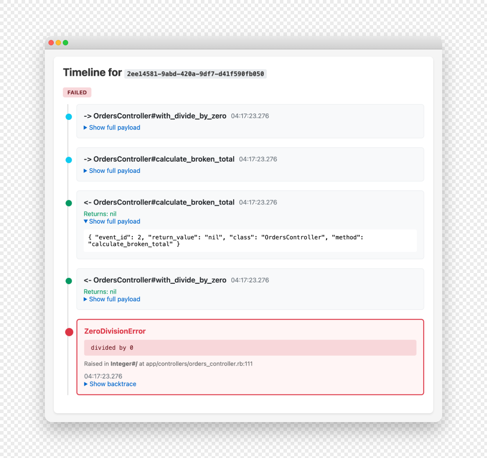

# EventTimeline

Debug Rails apps by replaying method calls from any request.

You get a bug report: "Order failed for user X". You check the logs, see a 500 error, but the stack trace doesn't tell you what state the app was in or what data was being processed.

## What you get



- A SUCCESS or FAILED badge for the request.
- Every call to a watched method in order, with its params, its return value and a timestamp.
- The exception class and message, the method, file and line that raised it, and the backtrace.
- The full recorded payload of any event, one click away.

## Why

- Requests stay fast. Expected overhead is listed below.
- Code outside watched files runs at tracker-off speed.
- A crash is always recorded with its source location, even when the request hit the event cap.

| Expected overhead (dummy app)      | Cost   |
| ---------------------------------- | ------ |
| Per request, small action          | 0.5 ms |
| Flush of 500 events at request end | 15 ms  |

## How it works

- Only the methods you watch are traced. Each one gets its own TracePoint, attached when its class loads.
- Events are buffered per request and written to the database in one insert when the request ends.
- Sensitive values are filtered by default, for example password, token and secret.

## Install

```ruby
gem 'event_timeline'
```

```bash
bundle install
rails generate event_timeline:install
rails db:migrate
```

Tell it what to track:

```ruby
# config/initializers/event_timeline.rb
EventTimeline.configure do |config|
  config.watch 'app/services'
  config.watch 'app/models'
end
```

## Usage

Make a request, grab the request ID from logs, visit:

```
/event_timeline/sessions/abc-123-def
```

You'll see the call timeline with params and return values. If the request crashed, you'll see the exception with its source location and backtrace.

## Limitations

- Only tracks Ruby method calls (not SQL queries or HTTP calls)
- Methods defined at runtime, after their class loaded, are not traced
- Large values get truncated

## Docs

- [Configuration](docs/CONFIGURATION.md): watched paths, filtering, retention, truncation, runtime control, custom correlation IDs
- [Release notes](RELEASE_NOTES.md)

## License

MIT
